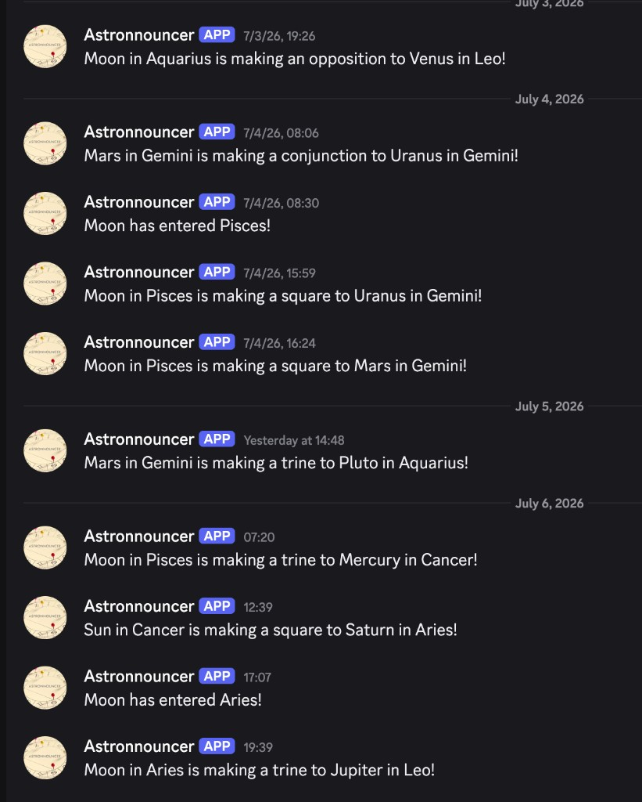

# Astronnouncer


A lightweight Discord bot that announces planetary transits using the [Swiss Ephemeris](https://www.astro.com/swisseph/swephinfo_e.htm).

It posts to Discord when planets:

- **Enter a new sign** — `Moon has entered Aries!`
- **Form a major aspect** — `Moon in Pisces is making a square to Uranus in Gemini!`
- **Change retrograde state** — `Mercury has entered retrograde in Cancer!`

Special cases: New Moon, Full Moon, and Cazimi.

## Documentation

Full technical documentation — detection logic, SQLite persistence, aspect coverage, deployment, and known limits:

**[docs/ARCHITECTURE.md](docs/ARCHITECTURE.md)**



## Quick start

### Environment

```txt
DISCORD_BOT_TOKEN="your-token"
MY_GENERAL_CHANNEL_ID="your-general-channel-id"
MY_TEST_CHANNEL_ID="your-test-channel-id"
DATABASE_PATH="./data/astronnouncer.db"
```

### Local development

```bash
pnpm install
pnpm dev
```

### Production (Fly.io)

```bash
pnpm build
fly deploy
```

Requires Node **24+**. Production SQLite lives on a Fly volume at `/data/astronnouncer.db`.

## Major aspects covered

| Aspect | Angle | Announced |
|---|---|---|
| Conjunction | 0° | Yes |
| Sextile | 60° | Yes |
| Square | 90° | Yes |
| Trine | 120° | Yes |
| Opposition | 180° | Yes |

Semisextile (30°) and quincunx (150°) are not implemented. See [docs/ARCHITECTURE.md](docs/ARCHITECTURE.md) for the full coverage matrix and operational limits.

## Feature requests

[Open an issue](https://github.com/sdee3/astronnouncer/issues/new) on GitHub.
