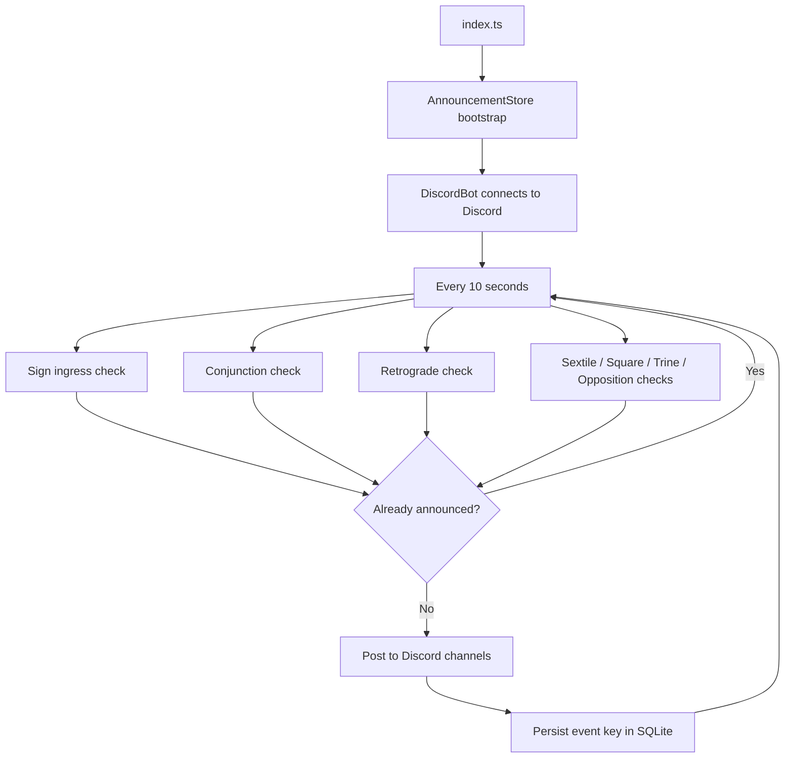

# Astronnouncer — Architecture & Transit Logic

Astronnouncer is a Discord bot that watches the live sky via the [Swiss Ephemeris](https://www.astro.com/swisseph/swephinfo_e.htm) (`sweph`) and posts announcements when planets change signs, change retrograde state, or form major aspects.

Production runs on [Fly.io](https://fly.io) as a long-lived Node.js process (PM2 inside Docker). There is no public HTTP API — the bot connects outbound to Discord.

---

## Example output

Real messages from the bot after the July 2026 restart:


Typical message formats:

| Type | Example |
|---|---|
| Sign ingress | `Moon has entered Aries!` |
| Aspect | `Moon in Pisces is making a square to Uranus in Gemini!` |
| Retrograde | `Mercury has entered retrograde in Cancer!` |
| Special | `New Moon in Cancer!` / `Full Moon in Leo!` / `Venus Cazimi in Leo!` |

---

## High-level flow



### Startup sequence

1. Load Swiss Ephemeris files from `public/`.
2. Open SQLite at `DATABASE_PATH` (default `/data/astronnouncer.db` on Fly).
3. **Bootstrap** — silently record currently exact aspects and retrograde states so a restart does not spam Discord.
4. Seed in-memory retrograde state and planet position baselines.
5. Connect to Discord and begin the 10-second poll loop.

---

## Planets tracked

All classical + modern bodies via `sweph`:

| Planet | Ephemeris flag |
|---|---|
| Sun | `SE_SUN` |
| Moon | `SE_MOON` |
| Mercury | `SE_MERCURY` |
| Venus | `SE_VENUS` |
| Mars | `SE_MARS` |
| Jupiter | `SE_JUPITER` |
| Saturn | `SE_SATURN` |
| Uranus | `SE_URANUS` |
| Neptune | `SE_NEPTUNE` |
| Pluto | `SE_PLUTO` |

Positions use **geocentric ecliptic longitude** with speed flag (`SEFLG_SPEED | SEFLG_SWIEPH`) so retrograde is derived from negative daily motion.

---

## Transit types & detection logic

### 1. Sign ingress

**File:** `models/AstroWatcher.ts` → `models/DiscordBot.ts`

A planet **enters a new sign** when its ecliptic position hits exactly **0°00′** of that sign (degree and minute both zero within the sign).

- First poll after startup seeds positions **without posting**.
- Each subsequent poll compares against in-memory `previousPlanetPositions`.
- On crossing, posts: `{Planet} has entered {Sign}!`

**Re-entries are supported.** If Mercury enters Aries, leaves, and re-enters Aries weeks later, both events post because dedup keys include the UTC date of the ingress.

### 2. Major aspects

**File:** `models/AspectChecker.ts`

Every 10 seconds, all planet pairs are evaluated. A pair is only processed when the **faster planet** is listed first (orbital speed order: Moon → Mercury → Venus → Sun → Mars → Jupiter → Saturn → Uranus → Neptune → Pluto). This ensures consistent phrasing, e.g. *"Moon in Pisces is making a square to Uranus in Gemini"* rather than the reverse.

#### Aspects covered (Ptolemaic / major)

| Aspect | Separation | Checked |
|---|---|---|
| **Conjunction** | 0° (same degree & minute within sign) | Yes |
| **Sextile** | 60° | Yes |
| **Square** | 90° | Yes |
| **Trine** | 120° | Yes |
| **Opposition** | 180° | Yes |
| Semisextile | 30° | **No** |
| Quincunx (inconjunct) | 150° | **No** |

An aspect is considered **exact** when:

1. The absolute longitudinal difference (normalised to ±180°) equals the aspect angle, **and**
2. Both planets share the same **minute** value (`minuteDiff === 0`).

This matches the screenshot behaviour — lunar aspects to outer planets fire every ~4 weeks as the Moon returns to the same sign and hits the exact angle again at a **different degree/minute**, producing a new storage key.

#### Special aspect messages

| Condition | Message |
|---|---|
| Moon conjunct Sun | `New Moon in {Sign}!` |
| Moon opposite Sun | `Full Moon in {Sign}!` |
| Planet conjunct Sun (not Moon) | `{Planet} Cazimi in {Sign}!` |
| Moon–Sun sextile / square / trine | **Suppressed** (intentional) |

#### Retrograde in aspect text

When either planet is retrograde at the moment of the exact aspect, the message includes `retrograde`:

> Mercury retrograde in Gemini is making a square to Saturn in Pisces!

### 3. Retrograde stations

**File:** `models/AspectChecker.ts`

Retrograde is detected when a planet's ecliptic **speed** goes negative. The bot announces **state transitions only**:

- `{Planet} has entered retrograde in {Sign}!`
- `{Planet} has left retrograde in {Sign}!`

Sun and Moon are excluded (they do not retrograde in this model).

In-memory state tracks the previous retrograde flag per planet. SQLite records each transition with a dated key so repeated retrograde/direct cycles in the same sign are announced separately.

---

## Persistence layer

### Why SQLite exists

Originally all "already announced" state lived in memory and was lost on every PM2 restart or deploy. That caused duplicate posts after restarts and missed dedup across outages.

The bot now uses **Node.js built-in `node:sqlite`** (`DatabaseSync`) — no native npm SQLite dependency.

### Storage location

| Environment | Path |
|---|---|
| Production (Fly.io) | `/data/astronnouncer.db` on a mounted 1 GB volume |
| Local dev | `./data/astronnouncer.db` |

### Schema

```sql
CREATE TABLE announced_events (
  event_key   TEXT PRIMARY KEY,
  event_type  TEXT NOT NULL,   -- 'sign_ingress' | 'aspect' | 'retrograde'
  announced_at TEXT NOT NULL,  -- ISO-8601 UTC
  payload     TEXT             -- optional JSON metadata
);
```

WAL journal mode is enabled for safer writes across PM2 restarts.

### Event key formats

Keys are the dedup contract. Once a key exists, that event is never posted again.

| Event | Key pattern | Example |
|---|---|---|
| Sign ingress | `ingress:{Planet}:{Sign}:{YYYY-MM-DD}` | `ingress:Moon:1:2026-07-06` |
| Aspect | `aspect:{Aspect}:{P1}:{P2}:{S1}:{S2}:{d1}:{m1}:{d2}:{m2}` | `aspect:square:Moon:Uranus:12:3:14:0:14:0` |
| Retrograde | `retrograde:{Planet}:{direct\|retrograde}:{Sign}:{YYYY-MM-DD}` | `retrograde:Mercury:retrograde:4:2026-07-04` |

**Aspect keys use exact sky positions**, not dates. This means:

- Recurring lunar aspects (~4 weeks) get **new keys** when the exact degree/minute differs.
- A slow planet aspect that stays exact at the same degree/minute does **not** spam daily.
- A restart mid-aspect does **not** re-post (bootstrap seeds the current exact key).

**Sign ingress keys use dates** so the same planet re-entering the same sign on a different day always posts.

### Bootstrap (anti-spam on restart)

On every cold start, before the poll loop posts anything:

1. Record today's retrograde state per planet (no message).
2. Record all **currently exact** aspects at their current degree/minute (no message).
3. Seed in-memory planet positions (first poll, no ingress messages).
4. Seed in-memory retrograde state.

Sign ingresses are **not** bootstrapped into SQLite — mid-sign restarts rely on the position baseline instead.

### In-memory cache

A `Set<string>` mirrors all `event_key` rows at startup for O(1) lookups. Every `mark()` writes through to SQLite and the cache.

---

## Discord delivery

### Channels

| Mode | Behaviour |
|---|---|
| **Production** | Auto-discovers `#general` in every guild the bot is in, plus `#astronouncements` if present |
| **Development** | Posts only to `MY_TEST_CHANNEL_ID` |

### Poll intervals

| Setting | Default | Purpose |
|---|---|---|
| `ASTRO_CHECK_INTERVAL` | 10 000 ms | Sky checks (ingress, aspects, retrograde) |
| `CHANNEL_CHECK_INTERVAL` | 1 000 ms | Channel list refresh |

---

## Environment variables

| Variable | Required | Description |
|---|---|---|
| `DISCORD_BOT_TOKEN` | Yes | Discord bot token |
| `MY_GENERAL_CHANNEL_ID` | Prod | Your home server's `#general` channel ID |
| `MY_TEST_CHANNEL_ID` | Dev | Test channel for local development |
| `DATABASE_PATH` | No | SQLite file path (Dockerfile sets `/data/astronnouncer.db`) |
| `NODE_ENV` | No | `development` or `production` |

See `.env.example`.

---

## Deployment (Fly.io)

```
App:     astronnouncer
Region:  ams
Volume:  astronnouncer_data → /data
Runtime: Node 24 Alpine, PM2, Docker
```

```bash
pnpm build
fly deploy
fly logs        # verify "Announcement store bootstrapped" + "Astronnouncer is ready!"
```

The `:3000` proxy warning in Fly logs is expected — the bot does not serve HTTP.

---

## Coverage guarantee & known limits

### What is covered while the bot is running

| Category | Coverage |
|---|---|
| Sign ingress (all 10 bodies) | Yes |
| Conjunction | Yes |
| Sextile | Yes |
| Square | Yes |
| Trine | Yes |
| Opposition | Yes |
| Retrograde / direct stations (Mercury–Pluto) | Yes |
| New Moon / Full Moon / Cazimi | Yes |
| Recurring lunar aspects | Yes (new position key each occurrence) |
| Retrograde planet aspects | Yes (labelled in message) |
| Re-entry into same sign | Yes (dated ingress key) |

### Intentional exclusions

| Item | Reason |
|---|---|
| Semisextile (30°) | Not implemented |
| Quincunx (150°) | Not implemented |
| Moon–Sun sextile / square / trine | Suppressed; lunation specials used instead |
| Sun / Moon retrograde | N/A astronomically |

### Operational limits (cannot miss *while down*)

| Limit | Detail |
|---|---|
| **Downtime** | Events during an outage are not backfilled. The bot only watches the sky *now*. |
| **10-second poll** | Detection requires the exact minute (and 0°00′ for ingress) to coincide with a poll tick. Fast-moving bodies could theoretically slip between ticks, though the 10 s interval makes this rare. |
| **Exact-minute aspects** | Aspects must match to the arcminute. A aspect exact between polls but separated by the next tick may be missed. |
| **0°00′ ingress** | Sign changes are detected only at exactly 0°00′ of the new sign, not at the theoretical crossing instant if the planet moves quickly past that point between polls. |

### Design goal

> **While online, no duplicate announcements — and every distinct transit gets exactly one post.**

The SQLite layer ensures restart stability. Position-based aspect keys ensure recurring transits (especially lunar) fire again. Dated ingress and retrograde keys ensure re-entries and re-stations are not suppressed.

---

## Project structure

```
astronnouncer/
├── index.ts                 # Entry: ephemeris path, store bootstrap, bot start
├── config/
│   └── config.default.ts    # Env vars & intervals
├── db/
│   ├── AnnouncementStore.ts # SQLite read/write + bootstrap
│   ├── eventKeys.ts         # Dedup key builders
│   └── schema.ts            # CREATE TABLE
├── models/
│   ├── AstroWatcher.ts      # Swiss Ephemeris calculations
│   ├── AspectChecker.ts     # Aspect & retrograde detection
│   └── DiscordBot.ts        # Discord client, messaging, ingress
├── utils/
│   └── index.ts             # Types, planet constants, speed order
├── public/                  # Swiss Ephemeris data files (*.se1)
└── docs/
    ├── ARCHITECTURE.md      # This file
    └── images/              # Screenshots & diagrams
```

---

## Development

```bash
pnpm install
cp .env.example .env          # fill in tokens & channel IDs
pnpm dev                      # nodemon, development mode
pnpm test                     # event key unit tests
pnpm build                    # compile to build/
```

---

## Tests

`db/eventKeys.spec.ts` verifies:

- Distinct sign ingress keys for re-entries on different dates
- Distinct retrograde keys across dates
- Distinct aspect keys for recurring lunar aspects at different degrees
- Stable aspect keys while an exact aspect persists (no duplicate spam)
